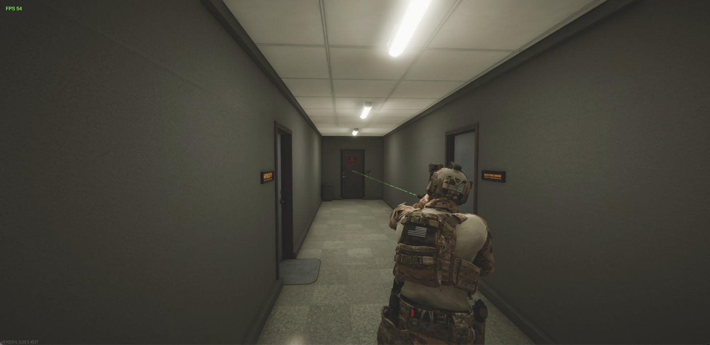

# Ghost Recon View

Ghost Recon-style third person for **OPERATOR**. An add-on for [BASS Third Person Mod](https://www.nexusmods.com/operator/mods/242). By Dr. Bendy.



**Download:** [Nexus Mods](https://www.nexusmods.com/operator/mods/247) (mod + Mac setup guide)

## What it does
- Aiming glides the camera from your shoulder into your scope
- A thin, realistic laser with a clean dot, also in night vision
- Adjust the laser in Settings → Mods

## Install
1. Install BepInEx 6 IL2CPP and BASS Third Person Mod
2. Drop `GhostReconView.dll` into `BepInEx/plugins`
3. Play

Not sure how? Drop the download into Claude or ChatGPT and say "Install this mod for me."

## Build from source
```
dotnet build source/GhostReconView.csproj -c Release -p:GameDir="<your OPERATOR folder>"
```

MIT License. Free to use and change, just keep the credit.
