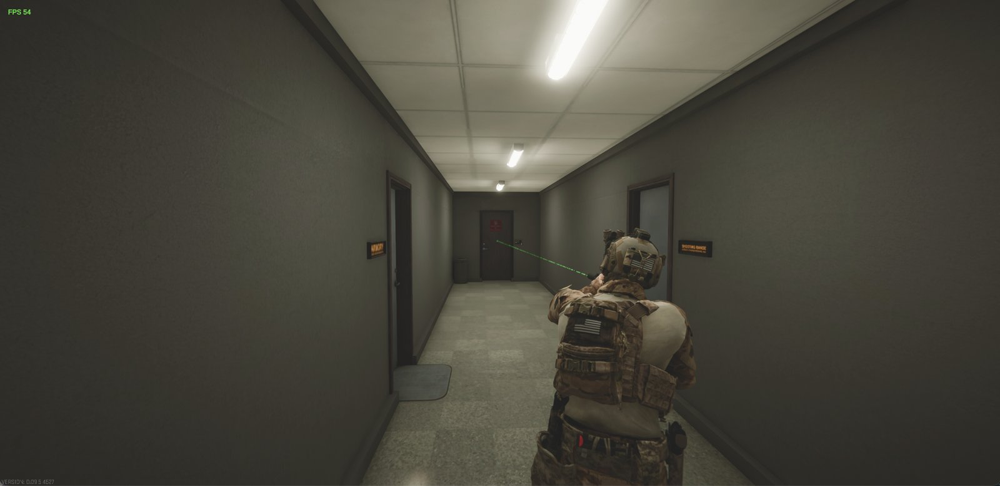
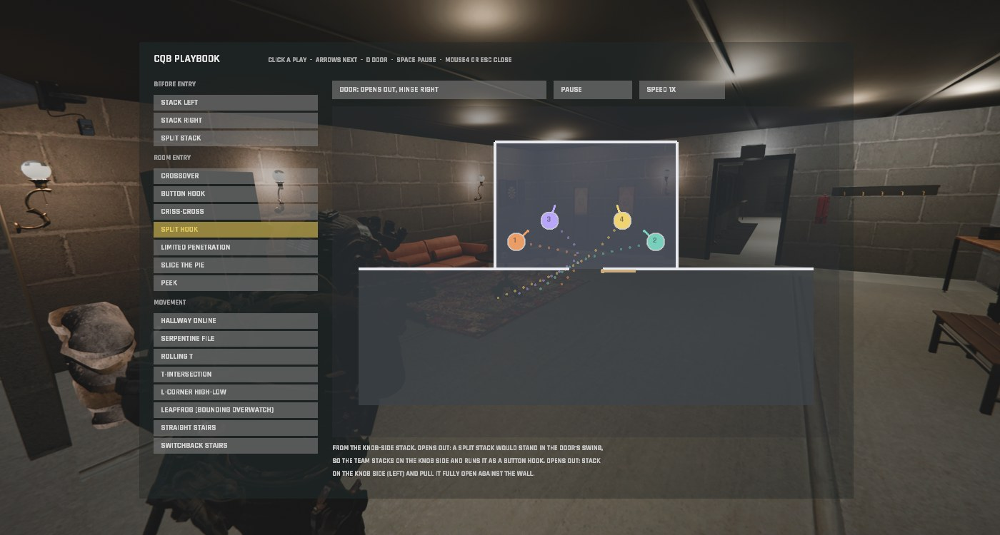
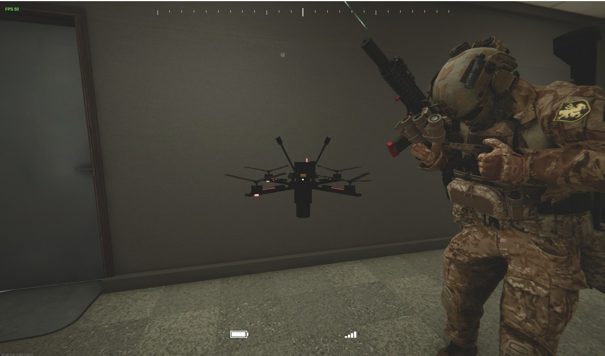

# Ghost Recon View 3.1.1

Mod for **OPERATOR**. Windows and Mac. By Dr. Bendy.

**Download:** [Nexus Mods](https://www.nexusmods.com/operator/mods/247). The download includes a setup guide (PDF) for Windows and Mac.

**Train like a real team.** Real CQB stacks, room entries and hallway moves, animated in the game, and a drill house to run them in.

## What it does
- **First and third person** in the same game (V). Two aim modes (Shift + V): over the shoulder, or aim drops you into first person
- **Doorways:** the view goes to first person fast and stays there a moment once you are through, to clear the corners (can be turned off)
- **Auto lean:** aim past the edge of cover and your operator leans around it
- **Smart reload (C):** racks an empty chamber, clears jams, reloads and chambers. Bolt rifles cycle by themselves
- **Real laser:** thin see-through beam ending in a small dot, works in night vision. Crosshair dot and third-person aim zoom
- **CQB playbook** (double-click Mouse 4): every stack, room entry and movement play, animated step by step, with door options
- **Drill house** in the Operation Room shoot house: corridors, a U turn, a T intersection, real doors and steel targets
- **Map card:** a live map of everything around you, following you, with doors and your teammates
- **Recon drone ( [ )** that marks enemies, **attack FPV drone ( ] )** with a warhead

- **Mic (K):** tap to keep your mic on, tap again to turn it off. Shows who is talking
- **Cinematic look** presets
- Every option in **Settings → MODS**, inside the game's own menu

## What you need
- OPERATOR on Steam
- The free [Archduke Interactive pack](https://archduke-interactive.com/downloads) (formerly ODG). It installs MelonLoader and the Third Person mod this builds on

## Install
1. Install the Archduke pack (run `ODG Ops.exe` once)
2. Copy `GhostReconView.Mod.dll` into OPERATOR's `Mods` folder
3. Start the game. Settings → MODS

On Mac, OPERATOR runs through Highball: the guide in the download has every step.
Not sure how? Drop the guide into Claude or ChatGPT and say "Set this up for me."

## Build from source
`source/` holds the code. `dotnet build -c Release`, with `<ML>` in the .csproj pointing at your `OPERATOR/MelonLoader` folder.

See [CHANGELOG.md](CHANGELOG.md).
