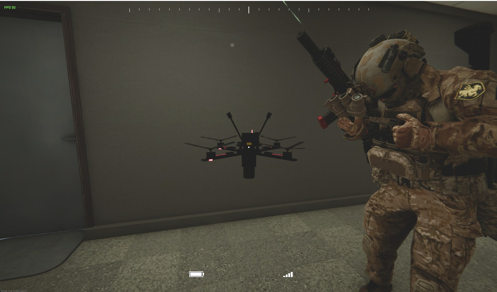
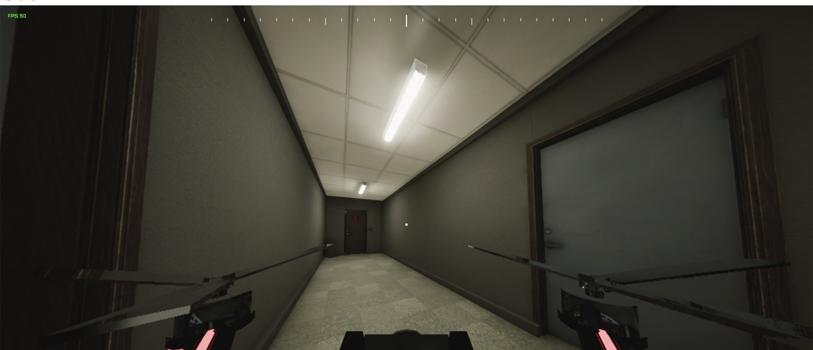

# Ghost Recon View 2.0 — 1st + 3rd person view, Drone mode, Mac setup

Mods for **OPERATOR**. By Dr. Bendy. Works on Windows and Mac.

**Download:** [Nexus Mods](https://www.nexusmods.com/operator/mods/247)


## Ghost Recon View (`GhostReconView.dll`)
Add-on for [BASS Third Person Mod](https://www.nexusmods.com/operator/mods/242).

- Play first person, switch to third person any time with one key. Aiming glides from your shoulder into your scope
- Auto lean: aim past the edge of cover and your operator leans by himself (the game's own lean, so everyone sees it)
- One reload key (C): racks an empty chamber, clears jams, reloads and chambers an empty gun
- A thin, see-through laser that fades out like a real one, also in night vision
- Crosshair you can tune. Everything in Settings → Mods

## Drone Operator (`DroneOperator.dll`)
Standalone. Works with or without Ghost Recon View.



- **Recon drone** `[` — 5-inch quad. Hold the crosshair on an enemy for a second to mark him. Land it within 3 m of you to get it back
- **Attack drone** `]` — 7-inch FPV with a warhead. Side mouse button or hitting someone = boom. One per mission
- Your operator holds the game's tablet while you fly (everyone sees that)
- Chase view and FPV view (V). Night vision works in the drone view (N)
- W/S A/D move, scroll wheel for height, mouse to look, Backspace to land
- Real-ish physics: it banks, coasts and brakes. ~70 km/h recon, ~85 km/h attack. Hit a wall above ~15 km/h and it breaks into pieces that stay on the ground
- Enemies hear it, see it and shoot it down
- Battery ~2 min (setting), FPV motor sound, HUD with compass, battery and signal



## Install
1. Install BepInEx 6 IL2CPP (and BASS Third Person Mod if you want Ghost Recon View)
2. Drop the `.dll` files you want into `BepInEx/plugins`
3. Play. Settings → Mods has every option (needs OperatorModControls, included on Nexus)

Not sure how? Drop this README into Claude or ChatGPT and say "Install this mod for me."

## Known limits
- Other players see your tablet pose, your lean and the explosion (when you host). They don't see the drone itself yet
- The drone's AI targets are the game's bots. Real players are never targeted

## AI usage
Built with the help of Claude (Anthropic): it wrote most of the code from my ideas, I designed, tested and tuned everything in game.

## Build from source
```
dotnet build source/GhostReconView.csproj -c Release -p:GameDir="<your OPERATOR folder>"
dotnet build DroneOperator/DroneOperator.csproj -c Release -p:GameDir="<your OPERATOR folder>"
```

MIT License. Free to use and change, just keep the credit.
